# Pruebas · Parte 1 (Club de Taekwondo Nonote)

Rellena «Resultado obtenido» con *Correcto* o describe lo ocurrido. Si algo falló, anota la corrección.

## 1. Obligatoriedad y textos

| ID | Entrada | Resultado esperado | Resultado obtenido |
|---|---|---|---|
| T01 | Nombre de socio de 3 caracteres | Error | 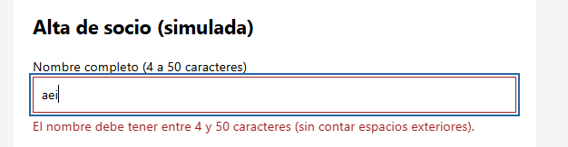 |
| T02 | Nombre de socio de 4 caracteres | Válido | 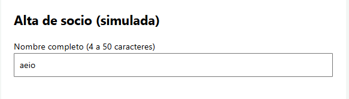 |
| T03 | Nombre de socio de 50 caracteres | Válido | 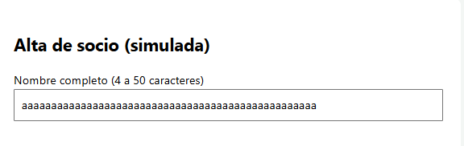 |
| T04 | Testimonio | 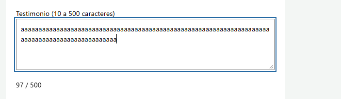 |
| T05 | Testimonio solo con espacios | Error | 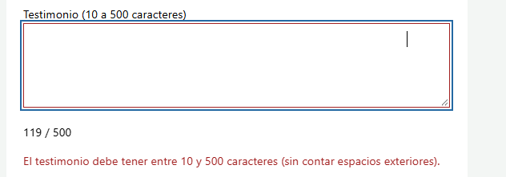 |

## 2. Números

| ID | Entrada | Resultado esperado | Resultado obtenido |
|---|---|---|---|
| N01 | Edad vacía | Error: Introduce tu edad | 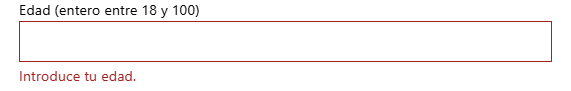 |
| N02 | Edad 17 | Error | 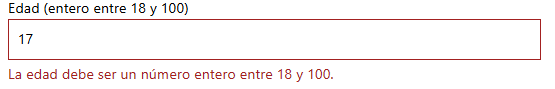 |
| N03 | Edad 18 | Válido | 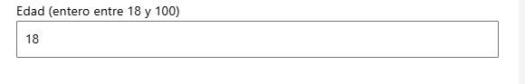 |
| N04 | Edad 18.5 | Error (no entero) | 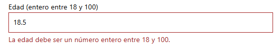 |
| N05 | Duración 14 | Error | 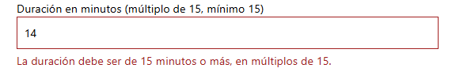 |
| N06 | Duración 15 | Válido | 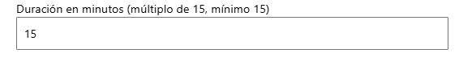 |
| N07 | Duración 20 | Error (no múltiplo de 15) | 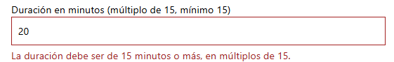 |
| N08 | Precio vacío | Error (el vacío no es cero) | 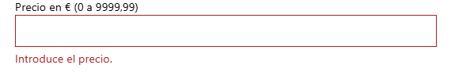 |
| N09 | Precio -1 | Error | 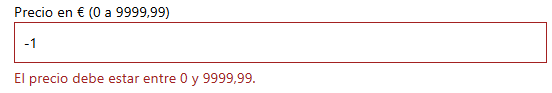 |
| N10 | Precio 0 | Válido | 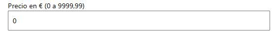 |
| N11 | Precio 5.123 | Error (más de dos decimales) | 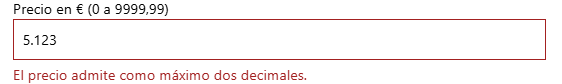 |

## 3. Fechas y selecciones

| ID | Entrada | Resultado esperado | Resultado obtenido |
|---|---|---|---|
| F01 | Noticia con fecha de ayer | Error | 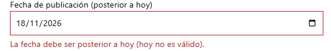 |
| F02 | Noticia con fecha de hoy | Error (hoy no es válido) | 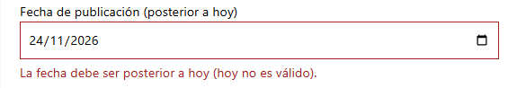 |
| F03 | Noticia con fecha de mañana | Válido | 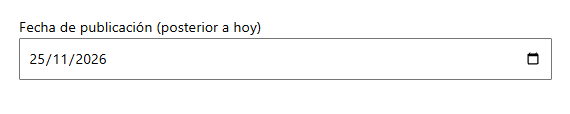 |
| F04 | Cita con fecha y hora pasadas | Error | 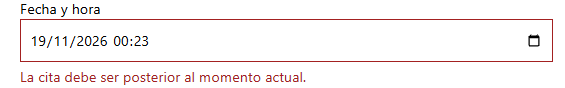 |
| F05 | Cita con fecha y hora futuras | Válido | 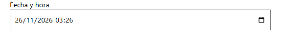 |