# Pruebas · Parte 2

Las pruebas unitarias están en `pruebas.js` (ejecutar con `node pruebas.js`; resultado: 37 casos correctos). Esta tabla recoge además la integración en el navegador.

## 1. Reglas de formato en la interfaz

| ID | Entrada | Resultado esperado | Resultado obtenido |
|---|---|---|---|
| R01 | Código DEP-007 | Válido | 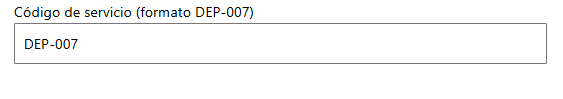 |
| R02 | Códigos dep-007, DEP-07, XDEP-007 | Error en cada caso | 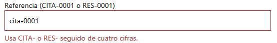 |
| R03 | Referencia CITA-0001 y RES-0001 | Válidas | 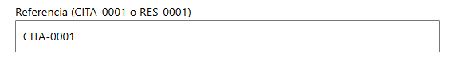 |
| R04 | Referencias XCITA-0001 y RES-001 | Error en ambas | 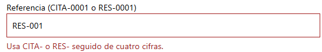 |

## 2. Métodos de texto

| ID | Entrada | Resultado esperado | Resultado obtenido |
|---|---|---|---|
| M01 | «Hay 12 clases y 3 pistas» + botón Extraer cifras | ["12","3"] | 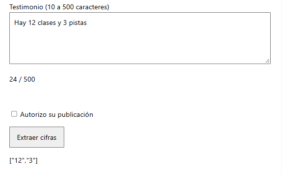 |
| M02 | Texto sin cifras | [] | 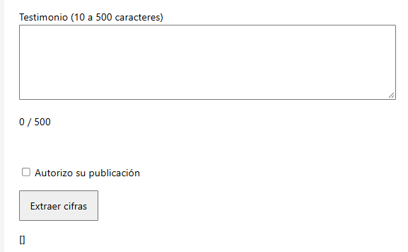 |
| M03 | Etiquetas «club, salud, verano» | 3 etiquetas | 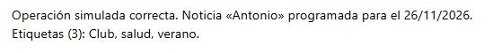 |
| M04 | Etiquetas vacías o « , ,, » | 0 etiquetas (ninguna) | 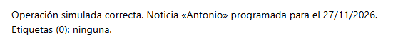 |

## 3. Demostración pattern frente a JavaScript

| ID | Entrada | Resultado esperado | Resultado obtenido |
|---|---|---|---|
| D01 | Código vacío | Nativo: bloquea por required. JS: inválido | 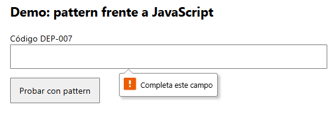 |
| D02 | DEP-007 | Nativo: pasa. JS: válido | 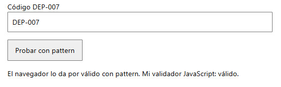 | - |
| D03 | DEP-007x (texto adicional) | Nativo: bloquea por pattern. JS: inválido | 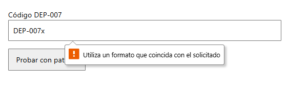 |
| D04 |  DEP-007 (espacio inicial) | Nativo: bloquea. JS: válido porque hace trim() | 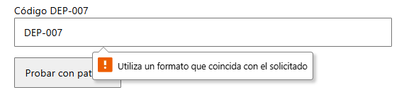 |